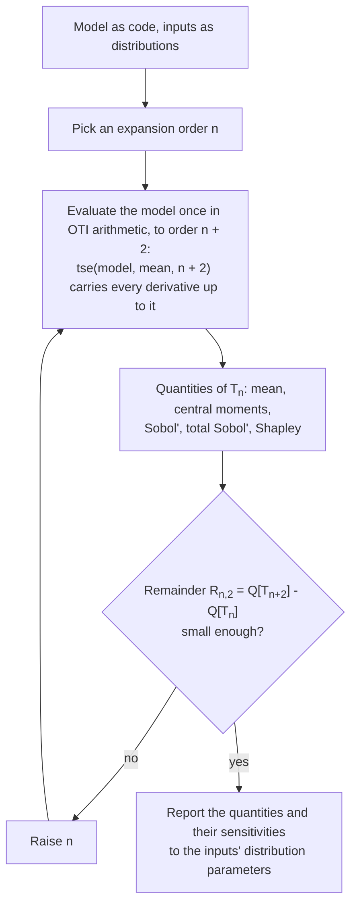

# TSEUQLib: Taylor Series Expansion Uncertainty Quantification Library
Construct Taylor series expansions for surrogate modelling. Compute UQ and sensitivity analysis metrics of the Taylor series expansion.

# Features

| Function              | Description                                                     | Symbol |
|----------------------|-----------------------------------------------------------------|--------|
| `tse`                | *n*-th-order Taylor Series                                      | $T_{n}(\boldsymbol{x})$ |
| `expectation`        | Expected Value                                                  | $E\left[T_{n}(\boldsymbol{x})\right]$ |
| `central_moment`     | Central Moment                                                  | $\mu_{k}\left[T_{n}(\boldsymbol{x})\right]$ |
| `sobol_indices`, `sobol_indices_by_term` | Partial Variances                    | $V_{ij\ldots}\left[T_{n}(\boldsymbol{x})\right]$ |
| `sobol_indices`, `sobol_indices_by_term` | Sobol’ Indices                       | $S_{ij\ldots}\left[T_{n}(\boldsymbol{x})\right]$ |
| `total_sobol_indices`| Total Sobol’ Indices                                            | $S_{i}^{T}\left[T_{n}(\boldsymbol{x})\right]$ |
| `shapley_values`     | Shapley effects                                                 | $\phi_{i}\left[T_{n}(\boldsymbol{x})\right]$ |
| `remainder`          | Error of $\xi\left[T_{n}(\boldsymbol{x})\right]$              | $\varepsilon\left[\xi\left[T_{n}(\boldsymbol{x})\right]\right]$ |
| —                    | Sensitivities of any of the above to distribution parameters, $\frac{\partial \xi[T_n(\boldsymbol{x})]}{\partial \theta_i}$: give each parameter its own OTI basis, any number at once | $S^{\xi}_{\theta_i}$ |

Inputs are independent, each normal (`'N'`), uniform (`'U'`), symmetric triangular (`'T'`), Kumaraswamy (`'K'`) or lognormal (`'LN'`).

**Verified.** Every quantity and sensitivity is checked against exact symbolic answers, and on polynomial models against the model's own exact values: see [`examples/verification`](examples/verification/README.md).

**Many inputs at low order.** `tse_moments.tse_central_moment` computes the same quantities from closed-form equations (extending those of Balcer et al., *J. Verif. Valid. Uncert. Quantif.* 8(2), 2023, doi:10.1115/1.4062459). It covers the expected value up to fifth order, the variance with partial variances and Sobol' indices up to fourth order (at fourth order, the variance only), and the third and fourth central moments up to third order. Inputs must be independent, and it evaluates many expansion points at once. It has no limit on the number of inputs, whereas pyoti caps `oti_moments` (the third and fourth central moments of a second-order expansion take at most 10 inputs), but it computes no parameter sensitivities.


# Installation
TSEUQLib runs on pyoti, from OTILib (https://github.com/mauriaristi/otilib). pyoti is published on the `mauriaristi` conda channel for Linux and macOS; there is no Windows build, so on Windows use WSL. Create a conda environment with pyoti and the other dependencies, and activate it:
```bash
conda env create -f environment.yml
conda activate tseuqlib
```
pyoti 1.2.1 requires Python 3.13. To build pyoti from source instead, follow the OTILib instructions.

Run the tests with:
```bash
python -m pytest tests
```
Add `-n auto` to spread them over all cores, as CI does.

# Usage

## Workflow



Look two orders ahead: the next order alone can add little while the one after does not (see panel (b) of the cantilever example).

## Quick start

```python
import numpy as np
import tseuqlib as tuq

def model(x):  # ordinary code; it also runs on OTI numbers
    P, E, L = x
    return 4e-6 * P * L**3 / (E * 0.05 * 0.1**3)

names = np.array(["N", "LN", "U"])  # normal load, lognormal modulus, uniform length
a = np.array([1000.0, np.log(200.0), 1.95], dtype=object)
b = np.array([100.0, 0.05, 2.05], dtype=object)
n = 3

mom = tuq.rv_central_moments([names, a, b], 4 * n)
mom.compute_central_moments()
tq = tuq.tse_uq(len(names), tuq.build_rv_joint_moments(mom.rv_mu))
y = tuq.tse(model, mom.rv_mean, n)  # T_3, from one evaluation of the model

mean, var = tq.expectation(y), tq.central_moment(y, 2)
S, V = tq.sobol_indices_by_term(y)  # S[(1,)], S[(1, 2)], ... keyed by input numbers
S_total = tq.total_sobol_indices(y)
miss = tq.remainder(tq.central_moment, y, 1, 2, 2)  # how much T_1's variance misses
print(mean, var, S[(1,)], S_total, miss)
```

For sensitivities to a distribution parameter, give it its own OTI basis above the inputs' (here the standard deviation of the load, on basis 4) and compute as before. Every quantity then carries the derivative; any number of parameters can be followed at once, one basis each.

```python
import pyoti.sparse as oti

b[0] = 100.0 + oti.e(4, order=1)
mom = tuq.rv_central_moments([names, a, b], 4 * n)
mom.compute_central_moments()
tq = tuq.tse_uq(len(names), tuq.build_rv_joint_moments(mom.rv_mu))
var = tq.central_moment(tuq.tse(model, mom.rv_mean, n), 2)
print(var.real, var.get_deriv([4]))  # the variance, and its derivative in the load's sd
```

## Examples

- [`examples/cantilever_beam.py`](examples/cantilever_beam.py): the workflow above, step by step, on a cantilever with five uncertain inputs, compared with the true model.
- [`examples/verification`](examples/verification/README.md): the checks behind every number.
- `examples/ishigami_paper.py`, `examples/poly3_paper.py`: the examples of the TSEUQLib paper. Run them from `examples/`, e.g. `cd examples && python ishigami_paper.py`.


# Copyright
LANL **O5031**

© 2025. Triad National Security, LLC. All rights reserved.

This program was produced under U.S. Government contract 89233218CNA000001 for Los Alamos National Laboratory (LANL), which is operated by Triad National Security, LLC for the U.S. Department of Energy/National Nuclear Security Administration. All rights in the program are reserved by Triad National Security, LLC, and the U.S. Department of Energy/National Nuclear Security Administration. The Government is granted for itself and others acting on its behalf a nonexclusive, paid-up, irrevocable worldwide license in this material to reproduce, prepare. derivative works, distribute copies to the public, perform publicly and display publicly, and to permit others to do so.
