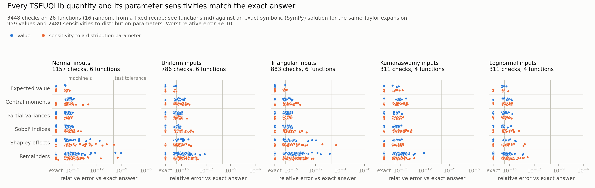
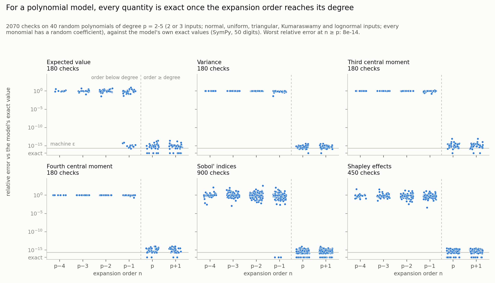
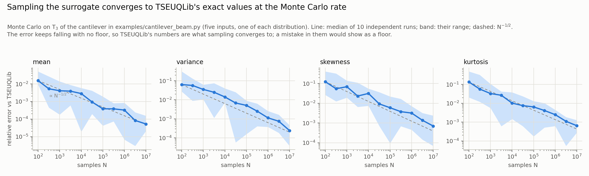

# Verification

Three figures. The first checks the implementation: every quantity and
sensitivity against the exact answer for the same Taylor expansion. The
second checks the method: on polynomial models, the quantities equal the
model's own exact values once the expansion order reaches the degree. The
third is for readers who trust sampling: Monte Carlo on the surrogate
converges to TSEUQLib's numbers.

## The implementation



**What is checked.** Every quantity TSEUQLib returns for a Taylor series
expansion T_n: the expected value, the central moments 2 to 4, the partial
variance and Sobol' index of every subset of inputs, the Shapley effects, and
the remainder error estimates. And for each, its derivative with respect to
the parameters of the input distributions.

**Against what.** An exact symbolic answer. `tests/oracle.py` builds the same
Taylor series with SymPy and integrates it exactly against the input
distributions. It shares no code with the library.

**Which functions.** [`functions.md`](functions.md) lists every function with
its inputs, expansion order n, nominal parameters, and the parameters
perturbed. Two per distribution were picked by hand while developing the
library's fixes (one has an x1·x2² term, whose sensitivity needs a cross term
the library once dropped). The rest come from a fixed random recipe
(`random_function` in `verify_all.py`, seed 20261101) and were not tuned.

**What "sensitivity" means.** The derivative of each quantity of the current
surrogate T_n, built once at the nominal mean, as a distribution parameter
moves only the input distribution. Each function runs once with several
parameters perturbed at once, one OTI basis each; every derivative is
compared with its own single-parameter exact answer.

**Reading the figure.** Each dot is one check; blue are values, orange
sensitivities. Relative error is |library − exact| / |exact|; for quantities
that are exactly zero it is measured on the scale of their group (the same
function, quantity family and parameter). Errors below 1e-17, exact zeros
included, sit at the "exact" floor. The hairlines mark machine ε and the
test suite's tolerance, 1e-10.

A few dots sit just past that line (5 of 3,448, worst 9e-10; run on
2026-11-01, with the Kumaraswamy cases rerun on 2026-11-02 after the fix to
their moments). Each is a very small quantity formed as a difference of much larger
ones: a remainder about 1e-7 the size of its partial variance, or a Shapley
sensitivity near 1e-7 built from larger partial-variance terms. Measured on
the scale of those larger terms, their errors are 1e-16, machine precision;
a tiny difference cannot be expected to carry more relative accuracy than
that.

**Reproduce it.** From the repository root:

```bash
python -B examples/verification/verify_all.py      # about 45 min; writes the CSV and functions.md
python -B examples/verification/plot_verification.py
```

`verification_results.csv` is the table behind the figure: every check, with
the library's value and the exact one.

## The method, on polynomials



**What is shown.** For a polynomial model of degree p, a Taylor series of
order n >= p is the model itself, so every quantity TSEUQLib returns (the
expected value, central moments 2 to 4, the Sobol' index of every subset,
the Shapley effects) should equal the model's own exact value. Left of the
dashed line, the order is below the degree: what truncating early costs.

**Against what.** The model's exact values, with no Taylor series involved:
the polynomial is expanded algebraically and integrated against each
input's exact central moments (SymPy, evaluated to 50 digits). Sobol'
indices come from conditional variances, Shapley effects from the
permutation definition, so the reference shares no formula with the
library.

**Which polynomials.** 40 random ones, not tuned: degrees 2 to 5, two or
three inputs, each of the five input distributions, with a random
coefficient on every monomial (`polynomial_exactness.py`, seed 20261102).
The monomials are in standardized inputs, so every order carries about
equal weight. That is why the error does not shrink as n approaches p:
leaving out any order costs about as much as leaving out any other. In a
typical model's Taylor series the orders shrink, and so does the error.

**Result.** Worst relative error at n >= p: 8e-14, over 2,070 checks.
Until 2026-11-02, Kumaraswamy inputs reached 7e-6 here: their central
moments came from a double-precision alternating sum, which cancels at high
orders. They are now computed in extended precision.

The low cluster of expected values at n = p - 1 is real: with symmetric
inputs (normal, uniform, triangular) and odd p, every top-degree term
raises some input to an odd power, whose mean is zero, so the expected
value is already exact one order early.

**Limits.** "Any polynomial" here means degree 5 or less on two or three
inputs: pyoti's basis limits cap the fourth central moment of high-order
expansions at three inputs.

**Reproduce it.**

```bash
python -B examples/verification/polynomial_exactness.py   # about 15 s; writes polynomial_results.csv
python -B examples/verification/plot_polynomial_exactness.py
```

## Monte Carlo



TSEUQLib integrates the Taylor series exactly, so sampling the series
itself must approach its numbers with error shrinking like N^(-1/2) and no
floor; a mistake in the library would show as the error levelling off at
its size. Here T_3 of the cantilever in `examples/cantilever_beam.py` (five
inputs, one of each distribution) is sampled up to 10^7 times in each of 10
independent runs (`mc_convergence.py`, about 2 min). At 10^7 samples the
mean is off by 2e-5 to 1.5e-4 relative, as its standard error (9e-5)
predicts.

## Also checked

**In `tests/`.** The same quantities against finite differences
of the plain outputs (a check independent of SymPy), Monte Carlo on the
surrogate (`examples/sensitivity_check.py`), and the numbers in the TSEUQLib
paper (`tests/test_paper.py`).

**Not covered.** Normal, uniform, triangular, Kumaraswamy and lognormal
inputs are verified; beta is not supported (the library raises an error).
pyoti limits how many inputs and parameters fit at high orders (at most 5
bases for the fourth central moment at n = 3); the library raises a clear
error past that limit.
